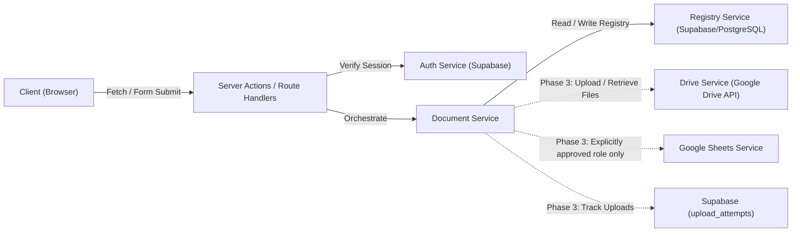
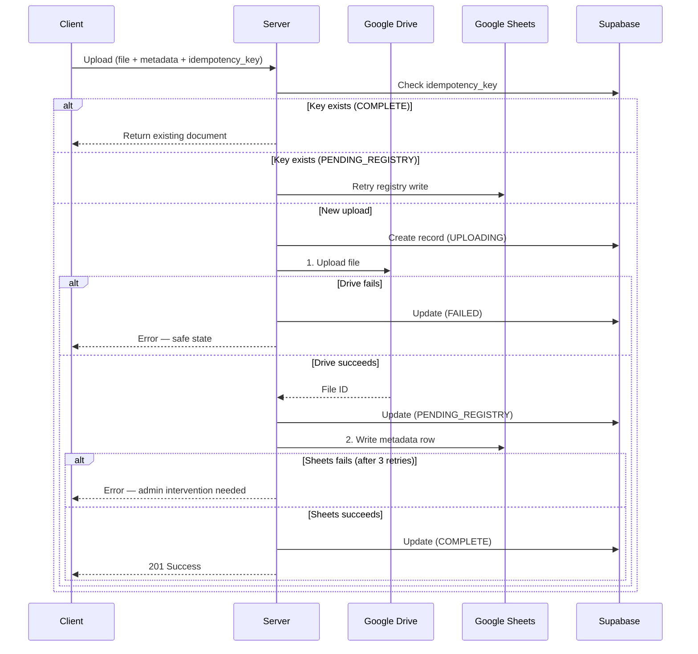

# System Architecture

## 1. High-Level Architecture [CONFIRMED]

The application acts as a controlled, secure interface between KWD staff and KWD's existing Google infrastructure.

```
    KWD STAFF (Browser)
           ↓
    Next.js App (Vercel)
           ↓
    ┌──────────────────────────────────┐
    │        Server Actions /          │
    │        Route Handlers            │
    ↓                                  ↓
 Supabase/PostgreSQL              Google APIs [PHASE 3]
    │                                  │
    ├── Authentication                 ├── Google Drive (File Storage)
    ├── Users Table                    │
    ├── Roles                          └── Google Sheets [DEFERRED]
    ├── Document Registry
    ├── Upload Tracking [PHASE 3]
    └── Audit Logs [PENDING CONFIRMATION]
```

## 2. Core Component Responsibilities [CONFIRMED]

- **Google Drive:** Actual document file storage. Do NOT use Supabase Storage.
- **Google Sheets:** Not implemented in Phase 2. Any future synchronization role requires an explicit architectural decision and must not create a competing registry source of truth.
- **Supabase/PostgreSQL:** Authentication, authorized users, roles, and the Phase 2 application document registry. Future audit-related metadata remains subject to approval.
- **Vercel:** Application hosting and deployment.
- **GitHub:** Source control.

## 3. Server-Side Service Boundary [PROPOSED]

All future Google API interactions are isolated behind a service layer. The UI never calls Google APIs directly. Phase 2 registry operations use a server-side Supabase/PostgreSQL document registry service.



### Phase 2 Registry Service
- Read document metadata from the Supabase/PostgreSQL registry
- Search, filter, sort, and paginate document records
- Retrieve a single document record
- Update or archive records only when the relevant requirements are approved

### Drive Service [PHASE 3]
- Upload file to the correct Drive folder based on document type
- Retrieve file metadata from Drive
- Construct Drive view/download URLs
- Handle Drive API errors

### Google Sheets Service [PHASE 3, DEFERRED]
- No Phase 2 implementation
- Any future read/write or synchronization behavior requires an explicit architectural decision
- Must not create a competing document registry source of truth

### Document Service [PHASE 2 / PHASE 3 EXTENSION]
- Coordinate Phase 2 registry reads through Supabase/PostgreSQL
- Orchestrate the upload flow (Drive upload → Registry write)
- Handle idempotency (check upload_attempts table)
- Handle failure recovery
- Combine Drive and Registry data for document retrieval

### Auth Service
- Verify Supabase session
- Look up user and role from users table
- Enforce authorization on every request

## 4. Service Account Strategy [PROPOSED]

All Google API operations use a Google Cloud service account — NOT per-user OAuth.

- Service account credentials stored server-side only (environment variables)
- Service account granted Editor access on the target Drive folder and Sheet
- All uploaded files are owned by the service account, ensuring consistent access
- Never exposed to the client

## 5. Upload Consistency [PROPOSED]

The upload follows a strict ordered two-phase process in Phase 3. It is not part of the Phase 2 registry implementation:



**Failure scenarios:**

| Failure Point | System State | Recovery |
|---|---|---|
| Drive upload fails | No file exists, no registry entry | Safe. User retries. |
| Sheets write fails | Orphaned Drive file | Retry 3×. If still failing: mark PENDING_REGISTRY. Admin reconciliation UI. |
| Response lost to client | Upload may be complete | Idempotency key prevents duplicate on retry. |

## 6. Upload Idempotency [PROPOSED]

1. Client generates a UUID idempotency key when the upload form mounts
2. Key is sent with the upload request
3. Server checks `upload_attempts` table for this key:
   - `COMPLETE` → return existing document (no re-upload)
   - `PENDING_REGISTRY` → retry the Sheets write only
   - Not found → proceed with new upload
4. This handles: browser retries, double-clicks, Vercel request retries, lost responses

## 7. Concurrency [ASSUMPTION]

For a small team MVP, the following strategies are acceptable:

| Scenario | Strategy | Justification |
|---|---|---|
| Two users uploading simultaneously | Phase 3 concern | Upload concurrency depends on the approved Drive/registry integration design |
| Two users editing the same metadata | Last-write-wins | Small team; concurrent edits on the same document are rare |
| Duplicate document numbers | Client-side warning, no hard constraint | Numbering schemes vary by document type |

## 8. Architectural Simplicity [CONFIRMED]

The project intentionally avoids enterprise complexity. No Kubernetes, Redis, Kafka, Elasticsearch, microservices, message brokers, or complex event-driven architectures. The system must remain understandable to one or two developers.
